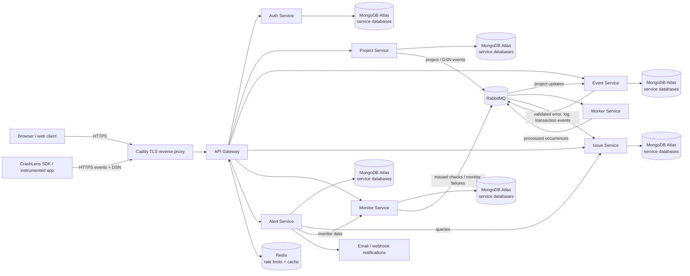

# CrashLens

CrashLens is an error monitoring and observability platform for application errors, logs, performance transactions, scheduled jobs, uptime checks, and alerting. This repository contains the backend microservices; the web client and SDK are maintained separately.

## Project links

| Resource                    | Link                                                 |
| --------------------------- | ---------------------------------------------------- |
| Live application / frontend | [crashlens.online](https://www.crashlens.online/)    |
| TriPlens                    | Link not provided yet                                |
| SDK on npm                  | [crashlens](https://www.npmjs.com/package/crashlens) |

## Related GitHub repositories

| Repository       | Description                        | Link                                                                                            |
| ---------------- | ---------------------------------- | ----------------------------------------------------------------------------------------------- |
| CrashLens        | Backend services (this repository) | [codewithnadeem14502/CrashLens](https://github.com/codewithnadeem14502/CrashLens)               |
| CrashLens Client | Web frontend                       | [codewithnadeem14502/CrashLens-client](https://github.com/codewithnadeem14502/CrashLens-client) |
| CrashLens SDK    | SDK source                         | [codewithnadeem14502/CrashLens-sdk](https://github.com/codewithnadeem14502/CrashLens-sdk)       |

## Demo Video

<iframe src="https://drive.google.com/file/d/1DB5bKsM9FHf403SGB3jhtedCxcbz1oLI/view?usp=drive_link" width="640" height="360" allow="autoplay" allowfullscreen></iframe>

## Architecture



### Services

| Service           | Responsibility                                                                                                                                 |
| ----------------- | ---------------------------------------------------------------------------------------------------------------------------------------------- |
| `api-gateway`     | Public `/v1` API entry point; routes requests to internal services and applies authentication, CORS, rate limiting, and request-log redaction. |
| `auth-service`    | Organizations, members, authentication, and access/refresh tokens.                                                                             |
| `project-service` | Projects and project DSNs; publishes project updates used by event ingestion.                                                                  |
| `event-service`   | Accepts and validates DSN-authenticated error, log, and performance events, then publishes them for asynchronous processing.                   |
| `worker-service`  | Processes ingested error events and detects issue occurrences.                                                                                 |
| `issue-service`   | Stores and serves grouped issues, logs, and performance data.                                                                                  |
| `monitor-service` | Cron/check-in and uptime monitoring; publishes failures for issue processing.                                                                  |
| `alert-service`   | Dashboards, queries, alert rules, and email/webhook notifications.                                                                             |
| RabbitMQ          | Message broker for event ingestion and asynchronous service communication.                                                                     |
| Redis             | Gateway rate-limit state and project caching.                                                                                                  |
| MongoDB Atlas     | Persistent data stores; each service uses its own database.                                                                                    |

The deployment runs the services on a private Docker network. Caddy is the only container that publishes ports to the host (80 and 443); MongoDB Atlas is external. `monitor-service` and `alert-service` should remain single-replica because their scheduled sweeps do not use leader election.

## Event flow

1. Create a project in the client and copy its DSN.
2. The application SDK submits events to the public `/v1/events` endpoint using that DSN.
3. `event-service` validates the DSN and payload, then queues accepted events in RabbitMQ.
4. `worker-service` processes error events; `issue-service` groups and stores resulting issues. Log and performance events are also consumed and persisted for their respective views.
5. `monitor-service` reports failed checks through the event pipeline, while `alert-service` evaluates configured rules and sends notifications.

## Run the backend

### Requirements

- Docker Engine and the Docker Compose plugin
- A MongoDB Atlas cluster and a database connection string
- A domain name pointing to the deployment host for the production Caddy setup

### Production-style Docker Compose deployment

The Compose configuration is designed for deployment with a public domain and MongoDB Atlas. See [DEPLOY.md](DEPLOY.md) for the complete VPS, DNS, TLS, demo provisioning, and operations runbook.

1. Copy `.env.deploy.example` to `.env` and set the required values. At minimum, configure `DOMAIN`, `MONGODB_BASE_URI`, `JWT_SECRET`, and `CORS_ALLOWED_ORIGINS`. Generate a strong JWT secret, for example with `openssl rand -hex 64`.
2. Validate the Compose configuration and start the stack:

   ```bash
   docker compose --env-file .env config --quiet
   docker compose --env-file .env up -d --build
   docker compose ps
   ```

3. Review service logs if any container does not become healthy:

   ```bash
   docker compose logs -f api-gateway event-service worker-service issue-service
   ```

Never commit `.env`, database credentials, signing secrets, DSNs, or generated demo credentials. The root `.env` is git-ignored.

### Development and tests

Each service is an independent Node.js package with its own `package.json` and tests. Install dependencies and run tests from the service directory. For example:

```bash
cd event-service
npm ci
npm test
```

Repeat for the service you are changing. Some packages also provide `npm run check` for a syntax check. Service-level `.env.example` files document local settings; start the required MongoDB, RabbitMQ, and Redis dependencies and configure each service before running its development script (`npm run dev`). There is no root-level npm workspace or single root test command.

## Demo access

Use the live application's demo option when available. The shared test-account password has intentionally not been copied into this public repository. Share credentials privately, and rotate them if they have been exposed. Operators can read about enabling and provisioning the separate demo-login flow in [DEPLOY.md](DEPLOY.md).

## Security

Do not open public issues with credentials, access tokens, private DSNs, or personal data. Use the repository's private security-reporting process for sensitive vulnerabilities. Rotate any secret that has been committed or shared publicly.

## License

No license is currently specified in this repository. Contact the maintainers before reusing or redistributing the code.
